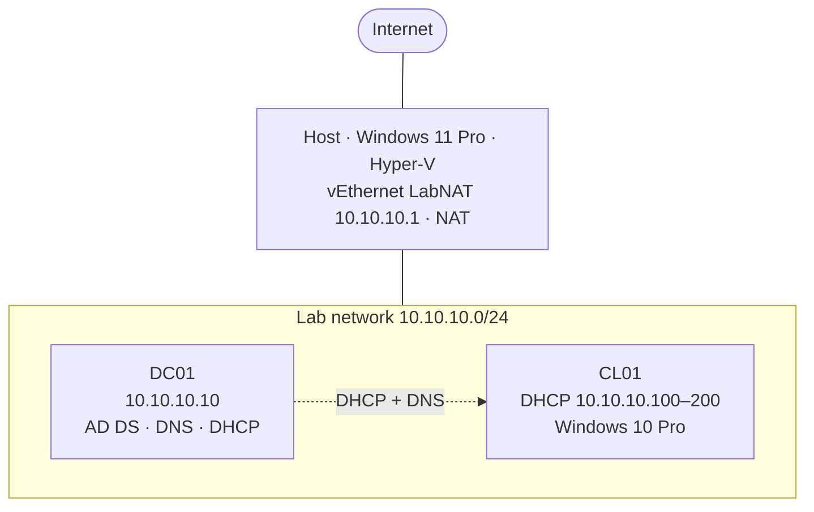

# 🛠️ Kortex ServiceDesk Lab - Corporate Windows Environment

# 📌 About the Project

A virtual Windows Server environment for a fictional company, **Kortex**, built
to practise ServiceDesk work and to grow toward system administration.

The environment is built mostly from PowerShell scripts, so it can be rebuilt
in minutes. The project continues
[NismoNET-LAB](https://github.com/marwat98/NismoNET-LAB), where I built an
Active Directory environment through the GUI.

**Company:** 60 employees in 5 departments: Management, Accounting, Sales,
Warehouse and IT.

# 🏗️ Architecture and Networking



| Machine | Role | Address |
|---|---|---|
| DC01 | Domain controller, DNS, DHCP | 10.10.10.10 |
| CL01 | User workstation, joined to the domain | DHCP |
| Host | Gateway with NAT | 10.10.10.1 |

Domain: `kortex.local` · NetBIOS: `KORTEX`

## 📅 Implementation

* **[Phase 0: Building the Lab](./docs/phase0-lab-build.md)**
  * Isolated lab network with NAT on a Hyper-V host.
  * Domain controller with DNS forwarders and the PDC Emulator configured as a reliable time source.
  * DHCP scope 10.10.10.100–200 with options 003, 006 and 015, authorised in AD, and a reverse lookup zone.
  * Workstation joined to the domain.
  * Company structure: OUs per department, `GG_` security groups, 60 user accounts.
  * Password reset and account unlock delegated to the ServiceDesk group, scoped to the user OU and verified with a negative test.
  * Remote PowerShell from the domain controller to the workstation for the ServiceDesk group.

## 🔧 Problems encountered

- [N1: DC01 could not reach its gateway](./notes/N1-wrong-virtual-switch.md)
- [N2: Remote session from DC01 to CL01 as sd.operator](./notes/N2-remote-session-sd-operator.md)
- [N3: First dcdiag on a new domain controller](./notes/N3-first-dcdiag.md)
- [N4: Domain join from a non-elevated console](./notes/N4-domain-join-not-elevated.md)

## 📁 Repository Structure

```
Kortex-ServiceDesk-Lab/
├── README.md
├── .gitignore
├── docs/              # phase documentation
│   ├── images/        # verification screenshots
│   └── logs/          # script output saved as .txt
├── scripts/           # PowerShell build scripts
└── notes/             # problems encountered while building the lab
```

## 🧰 Technologies

Windows Server · Active Directory · DNS · DHCP · PowerShell · Hyper-V · WinRM

## ⚠️ Disclaimer

This is a lab environment. All names and accounts are fictional. The shared
password used in the build scripts exists only in this lab and must never be
used anywhere else.
